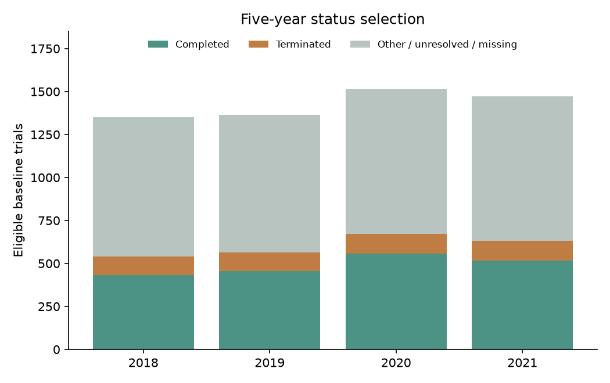
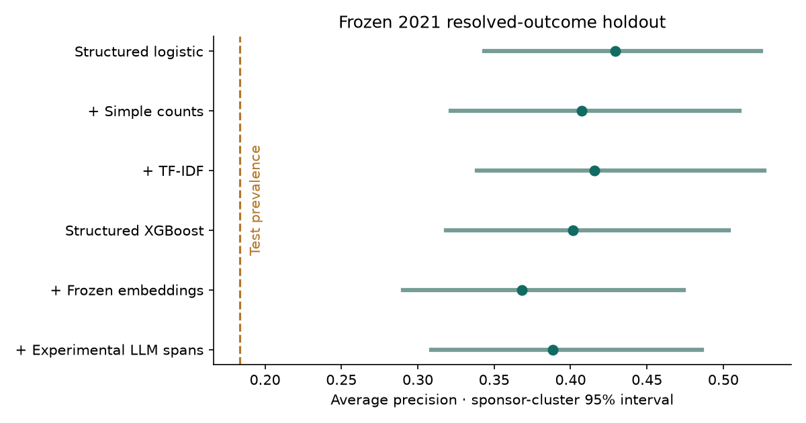
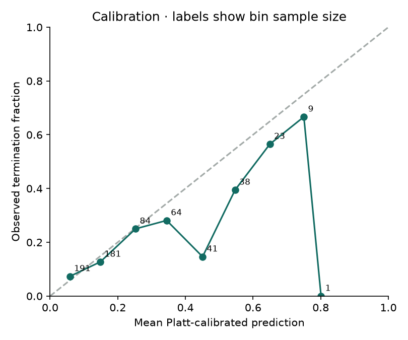

# Clinical trial early-termination research report

**Implemented local research demonstrator. Experimental extraction and free-form generation are withheld from semantic release.**

## Research question and estimand

Can historical baseline metadata and eligibility text distinguish trials reported Terminated versus Completed at a five-year snapshot? The answer applies only to the resolved, annual-landmark sample. It is not an estimate of termination probability for all newly starting trials.

Baseline sources are September 2018–2021 AACT archives; matched outcome sources are September 2023–2026. The conservative 90-day start-interval rule gives 5,703 unique trials. Most do not enter the binary comparison. No later record repairs baseline features.

| Baseline | Eligible | Completed | Terminated | Other / unresolved |
|---|---:|---:|---:|---:|
| 2018 | 1,349 | 434 | 108 | 807 |
| 2019 | 1,365 | 456 | 109 | 800 |
| 2020 | 1,517 | 557 | 116 | 844 |
| 2021 | 1,472 | 516 | 116 | 840 |

Selection is material: the model is conditioned on observing one of two reported statuses. Other statuses are not negative labels. Five years of follow-up does not solve registry reporting delay or selection bias. See the saved selection audit for differences in sponsor class, phase, enrollment and missingness.

## Locked evaluation

Training: 2018–2019, 1,107 trials / 217 terminations. Tuning: 2020 sponsor-hash partition, 332 / 47. Calibration: disjoint 2020 sponsor groups, 341 / 69. Final holdout: 2021, 632 / 116. Preprocessing fits on training only. Four candidate settings per model family; Platt calibration uses its separate partition.

**Retrospective temporal generalization, not historically deployable pseudo-prospective validation.** Training outcome labels from 2023–2024 were unavailable at the 2021 prediction landmark. Pretrained models were also not historically available, and their training contamination cannot be excluded. No actual prospective or clinical validation is claimed.

The primary comparison was TF-IDF versus structured logistic regression on average precision. Other families and sensitivities are secondary. Confidence intervals resample test lead-sponsor clusters and condition on the fitted models; they do not include training-set uncertainty.

## Holdout measurements

| Model | AP (95% interval) | ROC-AUC | Brier | Precision@10% | Recall@10% |
|---|---:|---:|---:|---:|---:|
| Structured logistic | 0.429 [0.343, 0.525] | 0.736 | 0.133 | 0.516 | 0.284 |
| + Simple counts | 0.407 [0.321, 0.511] | 0.710 | 0.138 | 0.500 | 0.276 |
| + TF-IDF | 0.415 [0.339, 0.527] | 0.748 | 0.132 | 0.547 | 0.302 |
| Structured XGBoost | 0.402 [0.318, 0.503] | 0.724 | 0.137 | 0.500 | 0.276 |
| + Frozen embeddings | 0.368 [0.290, 0.474] | 0.699 | 0.143 | 0.516 | 0.284 |
| + Experimental LLM spans | 0.388 [0.309, 0.486] | 0.697 | 0.139 | 0.469 | 0.259 |

No-skill AP reference is test prevalence, 0.184. Primary paired AP difference (TF-IDF minus structured): **-0.014, 95% interval [-0.047, 0.040]**.

The interval includes zero; this experiment does not establish a reliable incremental AP gain from TF-IDF.

The local demonstrator uses **+ Frozen embeddings**, chosen using the frozen tuning scores among qualified components. It was not chosen by maximizing holdout performance. Failed-gate LLM features remain research-only.

## Calibration and prioritization

| Probability mapping | Brier | Ten-bin ECE | Balanced accuracy at 0.5 | F1 at 0.5 |
|---|---:|---:|---:|---:|
| raw | 0.138 | 0.038 | 0.568 | 0.255 |
| platt | 0.143 | 0.052 | 0.611 | 0.364 |
| isotonic | 0.145 | 0.072 | 0.616 | 0.375 |

Platt was prespecified for the primary scores. Isotonic is a diagnostic comparison, not a post-test replacement. Sparse calibration bins have unstable observed rates; passing one finite evaluation does not establish reliable probabilities for a new population.

| Review fraction | Trials reviewed | Terminations captured | Recall | Precision | Lift |
|---|---:|---:|---:|---:|---:|
| 5% | 32 | 18 | 0.155 | 0.562 | 3.065 |
| 10% | 64 | 33 | 0.284 | 0.516 | 2.809 |
| 20% | 127 | 45 | 0.388 | 0.354 | 1.930 |

These are retrospective prioritization counts, not demonstrated business savings or effective interventions.

## Sensitivity, subgroup and drift evidence

| Secondary setting | Structured AP | TF-IDF AP |
|---|---:|---:|
| possible_date_interval | 0.446 | 0.433 |
| withdrawal | 0.596 | 0.595 |
| no_facilities | 0.430 | 0.414 |
| zero_imputation | 0.422 | 0.416 |
| test_without_near_duplicate_training_text | 0.429 | 0.415 |

Near-duplicate filtering removes 0 test texts with hashed character-gram cosine similarity >=0.9 to training. There are 131 lead sponsors shared across training and test; this is future-cohort transfer, not unseen-sponsor validation.

Subgroup results are saved by phase, sponsor class, coarse therapeutic area and US site listing. Metrics are withheld for groups with fewer than 30 trials or fewer than five examples of either class. Keyword therapeutic areas are imperfect and sparse subgroup results should not be used to rank clinical populations. Drift measurements describe changes; they do not prove their causes.

## LLM extraction: negative release result

The independent published CHIA annotations provide 155 test trials / 310 inclusion/exclusion documents. This is an external Phase-IV benchmark, not new annotations from this project. Exact entity-type/offset micro F1: LLM **0.139**, rules **0.162**. LLM precision 0.225; recall 0.101; valid schema 79.0%.

The extractor failed its pre-test release thresholds. Exact copied text is not proof of correct clinical typing or logic. Discontinuous spans, negation scope, semantic relations and normalized operator/unit accuracy are not solved. One test target annotation has a source-text/offset discrepancy; published offsets were retained and the discrepancy disclosed. The corpus-wide check found 21 such discrepancies among 48,870 annotated entities.

The final extractor uses pinned Qwen2.5-1.5B-Instruct weights, 4-bit local inference, an 1,800-character prefix and at most six spans of each type. 104 gold spans lie beyond the prefix. Published development pilots include a larger model that was slower and worse under this setup. Neither model was fine-tuned.

The same 2,412 primary resolved trials enter the exploratory LLM-feature risk comparison. Invalid outputs remain explicit failure flags; trials are never silently dropped. Any incremental discrimination cannot turn an inaccurate extractor into validated clinical understanding. No human adjudication of target-cohort extractions has been performed.

## Generated reports

On 40 frozen report cases, valid JSON rate was 0.0%. All generated reports failed the structured-output contract, so numeric/citation fidelity among accepted reports is not estimable. Zero accepted reports must not be interpreted as zero fabrication risk. All automated checks passed for 0.0% of cases. Deterministic templates reproduced the typed risk display in 100.0% of cases.

Free-form generation is withheld. Automated numeric/source checks are not an independent semantic-faithfulness or analyst-usefulness evaluation. A blinded review form and rubric are prepared but uncompleted. No claim that generated prose improves usefulness is supported. The default served report is deterministic and includes verified additive model associations and source citations.

Measured generation amortized p50/p95 latency: 0.802/1.171 seconds per report in batches. Template p50 formatting latency: 0.000011 seconds, excluding packet/model computation. Hosted API charges: zero; local energy cost was not measured.

## Engineering evidence and remaining gates

The implementation includes streamed archive ingestion, pre-join SQL aggregation, source checksums, physically separate outcomes, explicit feature allowlists, temporal evaluation, model/prompt/source registries, a local read-only FastAPI dashboard, container packaging, unit/integration checks and descriptive monitoring. API requests never query the live registry or mutate trial records.

The local demonstrator is suitable for research inspection and learning. It is not a production clinical system. Full project release remains gated on independent target-domain extraction/report review, demonstrated analyst usefulness and genuinely prospective evaluation where required. Negative component results are retained rather than relabeled as successful deployment.

Reproduce with [the runbook](../docs/reproducibility.md). See [the locked protocol](../docs/research_protocol.md), [feature dictionary](../docs/feature_dictionary.md), [annotation manual](../docs/annotation_manual.md), and raw JSON result tables under this reports directory.

## Sources

- [AACT historical flat-file catalog](https://aact.ctti-clinicaltrials.org/snapshots) — selected archive URLs and hashes are in configs/snapshots.json.

- [CHIA paper](https://doi.org/10.1038/s41597-020-00620-0) and [versioned annotations](https://doi.org/10.6084/m9.figshare.11855817.v2), CC BY 4.0.

- [Qwen2.5-1.5B-Instruct](https://huggingface.co/Qwen/Qwen2.5-1.5B-Instruct) and [MiniLM model card](https://huggingface.co/sentence-transformers/all-MiniLM-L6-v2). Pinned revisions and undocumented training-cutoff limits are recorded.
